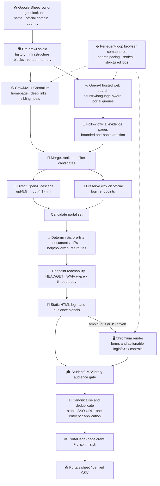

# reclaim-portal-agent

> ## 🕸️ Introducing Genie-V3
>
> The discovery engine has been rebuilt on a **five-layer architecture** —
> ~16,000 lines of rule engine replaced by **3,504 lines across 9 modules**.
>
> Two decisions moved out of the language model entirely: *which links are worth
> reading* (a knowledge-base filter) and *which legal document governs which
> portal* (a weighted bipartite graph matcher). The model is now a pure
> extraction parser.
>
> **Measured:** T&C recall **30% → 51%**; **119 of 465** organisations that V2
> found nothing for now have a portal; 26 languages learned on the fly.
>
> **V2 is still here, still running, still supported** — see
> [`agent/legacy/legacy_agent.README`](agent/legacy/legacy_agent.README).
> Every old import path works unchanged.

Genie finds the **student-login portal** for a university and the **terms &
privacy documents** that govern it, then writes both back to Google Sheets.
Output ships to SheerID as `orgId, portal url, tnc url`.

---

## Quickstart

```bash
python -m venv .venv && source .venv/bin/activate
pip install -r requirements.txt
playwright install chromium
cp .env.example .env          # fill OPENAI_API_KEY + Google creds

# V3 — run 200 organisations from a sheet tab
.venv/bin/python -m agent.v3_orchestrator \
    --sheet-id <SHEET_ID> --tab 'all orgs' --start-row 2 --count 200

# V3 — run a scattered list of org IDs instead of a row range
.venv/bin/python -m agent.v3_orchestrator \
    --sheet-id <SHEET_ID> --tab 'all orgs' --org-ids-file ids.json
```

### Look up a single university

No spreadsheet, no org ID, no OAuth — one domain in, portals and terms out.

```bash
# portals + the terms governing them
.venv/bin/python -m agent.lookup buet.ac.bd --name "Bangladesh University of Engineering & Technology"

# portals only — skips the portal crawl and graph matching, ~2x faster
.venv/bin/python -m agent.lookup unifran.edu.br --portals-only

# machine-readable
.venv/bin/python -m agent.lookup kbu.ac.th --json > result.json

# bounded first pass for a large batch; retry empty results without --fast
.venv/bin/python -m agent.lookup u-tokyo.ac.jp --portals-only --fast
```

```
  Bangladesh University of Engineering & Technology   (buet.ac.bd)
  ──────────────────────────────────────────────────────────────────
  [ERP]  BIIS
    portal : http://biis.buet.ac.bd/BIIS_WEB/Login.do
    terms  : https://bcc.buet.ac.bd/privacy-policy   (confidence 0.92, vertical-parent)
```

From Python:

```python
from agent.lookup import find_portals
result = await find_portals("buet.ac.bd", portals_only=True)
```

Exits non-zero when nothing is found, so it composes in shell scripts.

#### What GenieV3 will return as a portal

GenieV3 applies a hybrid static-HTML and Chromium login gate after discovery.
A result is kept only when the final page proves that it is a usable student,
academic, LMS, or library authentication surface. Strong proof is either:

- an identifier input, password input, and submit/login control; or
- a rendered, actionable login/SSO control on an official academic service.

When an informational page contains the real login control, Genie follows that
control and emits the destination rather than the surrounding help page. It
rejects PDFs and other documents, literal IP-address hosts, dead URLs,
non-HTTPS final pages, FAQ/help/policy/course/error routes, and staff-only,
admissions-only, alumni, HR, administrator, vendor, or parent logins unless the
page also proves student access. Recognised LMS and academic-library platforms
remain eligible when their login UI is intentionally minimal.

Before output, URLs are canonicalised: tracking and language-switch parameters
are removed, volatile SAML/OAuth session values are discarded, stable return
URLs are recovered where possible, and duplicate entry paths for the same
portal application are consolidated. This intentionally favours directly
usable, repeatable student-login URLs over raw recall.

Results land in `output/`:

```
output/verified_compliance_<date>.csv    orgId, portal_url, tnc_url
output/missing_tnc_portals_<date>.csv    orgId, portal_url
output/agent_run_<date>.log              timestamped, one record per line
```

### Run GenieV3 against a local Google Sheet

`scripts/run_v3_sheet.py` runs the current GenieV3 `find_portals` engine
against a normal organisation sheet and writes results to a separate output
worksheet. It does not use the legacy batch-discovery engine.

Before the first run, enable the Google Sheets API, create a Desktop OAuth
client, and save its downloaded JSON as `credentials.json` in the repository
root. The first run opens a browser for consent and stores the refresh token
at `.tokens/token.json`.

The source worksheet needs these headers:

| Header | Required | Purpose |
| --- | --- | --- |
| `Org name` | yes | Institution name |
| `Domain` | yes | Official website domain |
| `Country` | no | Proxy exit-country hint |

An Org ID is optional. When absent, Genie generates a stable ID from the
source-tab name, organisation name, and domain. The source worksheet is never
modified. Genie creates or updates a separate `Portals` worksheet in the same
spreadsheet, even when the source worksheet already has a column named
`Portals`.

Run a small test first:

```bash
GOOGLE_SHEET_ID="<sheet-id>" \
UNIVERSITIES_TAB_NAME="<input-tab>" \
PORTALS_TAB_NAME="Portals" \
.venv/bin/python scripts/run_v3_sheet.py --limit 3 --concurrency 2
```

Then process all source rows. Four concurrent lookups is a reasonable starting
point for a local machine; lower it if Chromium or the model provider begins
to rate-limit work.

```bash
GOOGLE_SHEET_ID="<sheet-id>" \
UNIVERSITIES_TAB_NAME="<input-tab>" \
PORTALS_TAB_NAME="Portals" \
.venv/bin/python scripts/run_v3_sheet.py --all --concurrency 4
```

For large sheets, use the two-pass runner. The fast pass performs a bounded
static-HTML crawl and low-context web search in parallel, deduplicates work by
registrable domain, caps candidates and network time, verifies real forms or
actionable student/LMS SSO controls without Chromium, defers legal-page work,
and writes Sheets updates on a background lane. Six workers with a 70-second
row deadline are the tested local defaults:

```bash
GOOGLE_SHEET_ID="<sheet-id>" \
UNIVERSITIES_TAB_NAME="<input-tab>" \
PORTALS_TAB_NAME="Portals" \
.venv/bin/python scripts/run_v3_sheet.py --all --fast
```

Fast mode intentionally leaves JavaScript-only, blocked, and ambiguous rows
unresolved rather than weakening the login-page guard. Retry only those rows
in normal mode to enable Chromium, crawl recovery, targeted endpoint rescue,
and legal/T&C enrichment. `--fast` implies `--portals-only`; it never claims
that a timed-out row has no portal.

The output tab contains portal URLs, matching legal-page URLs, and a
`GenieV3 status` column. The legacy `Overall T&C Verdict` column remains blank
for these runs because GenieV3 finds legal pages but does not run the older
content-verdict classifier.

---

## 1. The five layers

| | Layer | Job | Module |
|---|---|---|---|
| **L1** | Model | Direct OpenAI extraction and tier fallback | `openai_cascade.py` |
| **L2** | Discovery | Parallel crawl/search · multilingual filtering · evidence expansion · legal graph association | `crawler` · `filters` · `search_fallback` · `graph_matcher` |
| **L3** | Verification | Reachability · rendered authentication proof · student audience · canonical URL | `guardrails.py` |
| **L4** | Production | Per-event-loop browser limits, search pacing, retries, observability | `lookup.py` · `v3_orchestrator.py` |
| **L5** | Optimisation | Memory, caching, co-learning | `memory_cache.py` |

### Current adaptive-discovery architecture

The important change is that web search is no longer only an emergency step
after a failed homepage crawl. Crawl4AI and OpenAI hosted web search run as
independent discovery paths, then their evidence is merged before inference.
Neither path is trusted by itself: every proposed URL passes the same objective
browser and audience checks before it reaches the output.



### L1 — model cascade

GenieV3 calls OpenAI directly; OpenRouter is retired from the V3 execution
path. The default cascade is `gpt-5.5` → `gpt-4.1-mini`, configurable with
`GENIE_MODEL_TIERS`. A compatibility module remains only so older imports fail
gracefully during migration—it does not create an OpenRouter client.

The cascade escalates on validation errors, rate limits, transport failures,
and empty results. Model output is a proposal, not proof: explicit URLs found
by deterministic discovery are merged with it, and all candidates proceed to
the same Layer-3 verification.

### L2 — crawler, filter, graph

**Crawler** (`crawler.py`) renders in headless Chromium, images off, cache
bypassed, proxy exit country per-URL from the ccTLD, with a direct retry because
the proxy fails closed. It parses the rendered HTML itself — crawl4ai's
`result.links` is a filtered view that returned 3 links where the DOM held 50.

**Filter** (`filters.py`) is local matching over `agent_knowledge_base.json`.
It cuts a large rendered link set to a bounded candidate list. Country language
profiles contribute native portal/login vocabulary to crawling, filtering,
search queries, model context, and audience verification, so a previously
unknown URL naming convention is not rejected merely for being non-English.
When no keyword matches, a structural heuristic ranks plausible institutional
hosts and entry points rather than returning an empty set.

**Search** (`search_fallback.py`) uses OpenAI's hosted **web_search** tool
with an OpenAI model. For single-domain V3 lookup, primary Crawl4AI discovery
and web search run concurrently. Search results that point at an official
university evidence page receive a bounded one-hop crawl so the actual login
target can be recovered. In batch orchestration, search also supports rescue
and category expansion for missing ERP, LMS, and fee-payment capabilities.

Queries are **OR-grouped**, not space-separated, so the search request describes
alternatives rather than requiring every platform term on one result. Search
results are candidates only: they receive the same filtering, model
classification, reachability, rendered-login, student-audience, and URL
canonicalisation checks as crawl results.

Expansion suppresses the heuristic fallback: the row already has portals, so a
search that surfaces only news articles must contribute nothing rather than
dilute a working result.

**Graph matcher** (`graph_matcher.py`) decides which terms govern which portal:

```
W(P → C) = 0.40·S_domain + 0.40·S_semantic + 0.20·S_distance
         × S_ownership                        gate: W ≥ 0.40
```

`S_domain`: 1.0 exact host · 0.8 vertical · 0.7 sibling · 0.5 SaaS · **0.0 is a
hard veto**, because semantic + distance alone reach 0.60 and would clear the
gate — that is the ownership contamination V2 shipped 41 times.

### L3 — guardrails

Layer 3 has three separate responsibilities:

1. **Pre-network safety:** reject document URLs, literal IP hosts, known utility
   hosts, and content-only routes such as FAQ, help, policy, course, enrolment,
   documentation, and error pages.
2. **Reachability:** `2xx/3xx` are alive; `401/403/429` also prove that a server
   exists; `405` is retried with GET; timeouts receive one longer retry. This is
   availability evidence only, never sufficient evidence that a URL is a portal.
3. **Authentication and audience proof:** inspect static HTML, then render with
   Chromium when needed. Require a login form or actionable login/SSO control
   plus student, academic, LMS, or library context. If a container page links to
   the real login, return the actionable destination.

Accepted URLs are then normalised and deduplicated. Tracking/language parameters
and volatile session tokens are removed, stable SSO return targets are retained,
and multiple authentication routes for one application collapse to its best
reusable entry URL.

### L4 — operations

Batch rows can run concurrently, while heavyweight browser work is deliberately
bounded. Primary single-domain crawls default to one active browser and login
verification defaults to two. These semaphores are created per asyncio event
loop, which keeps CLI, tests, and sheet workers from sharing a loop-bound
primitive and eliminates cross-loop `RuntimeError` failures. OpenAI web search
has its own global turnstile and stagger; rate limits use exponential backoff.

### L5 — memory

`domain_history.json` (resolved orgs) · `infrastructure_block.json` (firewalled
hosts) · `tnc_memory.json` (vendor → legal URLs, keyed by **vendor** so one
lookup serves 542 institutions on `samarth.edu.in`).

**Co-learning:** when a portal is live *and* matched, the native phrase that
identified its T&C is banked into the knowledge base and folded into the live
matcher. A language is translated once, then becomes a local regex hit.

---

## 2. Setup

Requires **Python 3.11+**.

### Google credentials
Put a Desktop-app OAuth client at `./credentials.json`; the first run opens a
browser and caches a token at `GOOGLE_TOKEN_PATH`.

> The token **expires every 7 days** while the consent screen is in *Testing*,
> and long unattended runs die mid-batch. Publish the consent screen to
> production to stop this.

### Residential proxy — read before trusting any verdict

**It fails closed.** If the provider rejects our IP (`401 ip_blacklisted`),
every proxied fetch returns status 0 and healthy portals are recorded as dead.

```bash
# ALWAYS probe before a batch
.venv/bin/python -c "
from dotenv import load_dotenv; load_dotenv('.env')
import requests, agent.magic as M
print(requests.get('https://api.ipify.org',
      proxies=M._proxies('https://x.edu.br/'), timeout=25).text)"
# expect a FOREIGN exit IP — not a 401
```

The office IP is dynamic and macOS prefers IPv6, so whitelist the IPv6 `/64` as
well as a wide IPv4 range.

### Key environment variables

| Variable | Purpose |
|---|---|
| `OPENAI_API_KEY` | required for direct V3 inference and hosted web search |
| `GENIE_OPENAI_SEARCH_MODEL` | optional OpenAI web-search model override; default `gpt-5.5` |
| `GENIE_OPENAI_SEARCH_TIMEOUT_SECONDS` | hosted web-search timeout, default 90s |
| `GENIE_MODEL_TIERS` | override the cascade (comma-separated) |
| `GENIE_BROWSER_CONCURRENCY` | browser semaphore, default 6 |
| `GENIE_LOOKUP_BROWSER_CONCURRENCY` | concurrent primary Crawl4AI sessions in `agent.lookup`, default 1 |
| `GENIE_VERIFY_BROWSER_CONCURRENCY` | concurrent rendered login verifications, default 2 |
| `GENIE_SEARCH_CONCURRENCY` | global search turnstile, default 3 — quota is per account, not per code path |
| `GENIE_CAPABILITY_EXPANSION` | `0` disables opportunistic expansion, default on |
| `GENIE_GUARDRAIL_TIMEOUT` / `_RETRY` | liveness budgets, default 5s / 20s |
| `GENIE_MAX_CANDIDATES` | filter cap, default 40 |
| `USE_PROXY`, `RESIDENTIAL_PROXY_*` | residential proxy |

---

## 3. Running long batches

Every long driver follows the same shape, learned the hard way:

- **daemonised** via `scripts/_daemonize.py`, plus `caffeinate -dimsu` **started
  separately** — the daemon double-forks away from a `caffeinate` wrapper
- **sharded** N ways, each shard with its **own** done-file
- shard the **full** list, *then* drop completed items — sharding a pre-filtered
  list shifts positions between attempts and processes rows twice
- **pre-mark before fetching**, so a page that wedges the browser costs one row
- **staleness watchdog** — a dead Chromium spins where `SIGALRM` never lands;
  only `SIGKILL` on a stale log recovers it (no `timeout(1)` on macOS, and
  `perl -e alarm` is swallowed by the script's own handler)
- **empty `--report-remaining` means "unknown", not "done"** — a DNS blip
  otherwise burns the retry budget in seconds

V3 is resumable by default: `domain_history.json` is the shield, so a rerun
skips completed orgs. Use `--no-resume` for a clean baseline.

---

## 4. Hard-won rules

- **Uniqueness is per-org, not global.** "Have we seen this URL?" and "has *this
  org* had it?" are different questions.
- **Resolve sheet columns by header, never by letter.** Layouts have changed
  several times; letter-indexed writers silently corrupt the wrong column.
- **A form with 2+ inputs is not a login.** Require a `type="password"` field or
  a login-shaped URL returning **2xx/3xx** — a 404 is not a portal.
- **Validate what a T&C search returns.** Check the domain against the org's own
  before accepting, or you attach another university's policy.
- **`unreachable (status 0)` usually means slow or geo-blocked.**
- **Never tint sheet rows** unless asked. The verdict text is the signal.
- **Snapshot before every destructive write.**
- **Read what a filter dropped, not just how many.** Two silent-deletion bugs
  were invisible in the counts and obvious in the contents.
- **A scraped search engine fails silently, and that is worse than failing.**
  DuckDuckGo began serving a CAPTCHA page that parses as valid HTML, so the
  scraper read it as "no results". Across 128 orgs, 44 of 47 searches returned
  nothing and every one was recorded as a discovery miss rather than a search
  outage. A keyed API turns that into an explicit 401/429 you can act on.
- **Samarth: `.edu.in` is the student tenant, `.ac.in` is not.**
  `{inst}.samarth.edu.in` is a student portal; `{inst}.samarth.ac.in` is an
  employee, recruitment or admin console. The legacy engine enforced this;
  V3 did not until it was caught in review.
- **Search brings a noise class crawling never does.** Aggregators, rankings,
  news and ebook mirrors rank highly for "*university* fees/moodle/portal" and
  match our own keywords legitimately. They need their own blacklist group.

---

## 5. Data hygiene

`.gitignore` covers all of this:

- **`.env`, `token.json`, `credentials.json`** — never committed (verified).
- **`output/`** — all generated CSVs and logs, one directory mask.
- **`*.csv`, `*.log`** — kept as a backstop for strays elsewhere in the tree.
- **`state.db`** and all `*.db` / `*.sqlite`.

```bash
git status --porcelain -uall | grep -iE '\.(csv|log)$|\.env'   # must be empty
```

> **Known history exposure.** 51 CSV data files were committed before these
> rules existed and remain retrievable from pushed history. No credentials are
> in history. Purging needs `git filter-repo` plus a coordinated force-push.

---

## 6. Repository layout

```
agent/
  schemas · crawler · filters · openai_cascade
  guardrails · memory_cache · search_fallback · v3_orchestrator   ← V3
  config · sheets_client · state · proxy · regions                ← shared
  magic · pipeline · orchestrator · stages/                       ← shims
  legacy/          the V2 engine + legacy_agent.README
agent_knowledge_base.json   307 vendors, 10 categories, 247 reject terms
tnc_memory.json · domain_history.json · infrastructure_block.json
scripts/         111 operational scripts (V2 batch tooling)
genie/           FastAPI + Next.js app (deployed; runs on V2)
output/          generated CSVs and logs — gitignored
```

## 7. Per-university overrides — `domain_overrides.json`

Pin a known answer or hint discovery for a specific OrgID:

```json
{
  "664197": {
    "state": "Punjab",
    "exact_shortnames": ["pup", "punjabiuniversity"],
    "seed_urls": ["https://punjabiuniversity.samarth.edu.in/index.php/site/login"],
    "force_accept_seed_urls": true
  }
}
```

Fields: `state`, `exact_shortnames`, `extra_effective_domains`, `seed_urls`,
`force_accept_seed_urls`, `blocked_urls`, `tc_domain`, `notes`.

## 8. Troubleshooting

| Symptom | Cause / fix |
|---|---|
| Everything suddenly `unreachable (status 0)` | Proxy blocked — probe it, whitelist the current IP, re-check affected rows |
| `invalid_grant: Token has been expired` | 7-day OAuth token; re-auth interactively |
| A pass hangs at high CPU, no Chromium alive | Wedged renderer; watchdog SIGKILLs it, pre-mark skips the row |
| Verdicts written to the wrong column | Script hardcodes column letters — use a header-driven one |
| `401 authentication error` | check `OPENAI_API_KEY` and API-project billing/permissions |
| Run dies overnight | `caffeinate` must be started separately from the daemon |
| Cache never hits | Check the memory file path — a second empty file elsewhere reads as a permanent miss |
